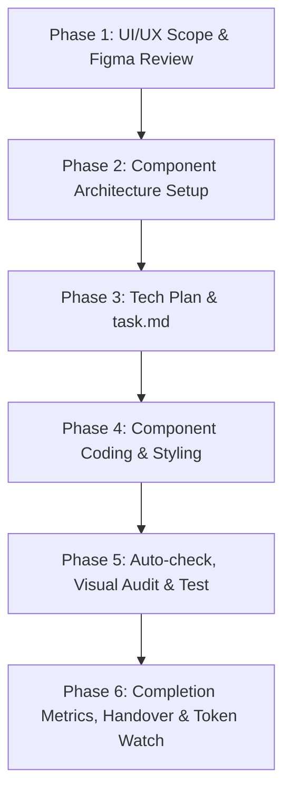

# 🎨 FRONTEND_MASTER_TEMPLATE (The Frontend & UI/UX Buddy Protocol)

Welcome! If you are an AI Coding Agent reading this file, you must immediately adopt the rules, modern React/Next.js practices, and UI/UX checklists defined in this document for frontend tasks.

**Target: Production-grade frontend with:**
- ⚡ High Lighthouse Scores (Performance, Accessibility, Best Practices, SEO)
- ♿ Accessibility (A11Y) Compliance
- 🛡️ Hydration Safety & Console Error Prevention
- 🏎️ Performance Optimization (60 FPS, Zero Layout Shifts)
- 📱 Responsive Design (Mobile-First approach)
- 🎨 Consistent UI/UX Design System Enforcement

---

## 📁 1. Modern Full-Stack/Frontend Structure (Next.js App Router)

Maintain a structured, clean, and decoupled component layout:

```text
your-project-root/
│
├── .agents/                        # AI Agent Frontend Memory & Guidelines
│   ├── AGENTS.md                   # Global frontend rules, standards & buddy persona
│   ├── prd_summary.md              # 100% line-by-line detailed PRD extraction & edge cases
│   ├── design_system.md            # Colors, spacing, typography tokens & visual rules
│   ├── component_registry.md       # Registry of all existing reusable components
│   ├── ux_standards.md             # States checklist (loading, empty, error, skeleton, success)
│   ├── design_debt.md              # Tracks styling hacks, shortcuts & design gaps
│   ├── architecture_summary.md      # Front-end module structure & state flows
│   ├── decisions.md                 # ADRs for frontend architecture choices
│   ├── known_issues.md             # Log of known UI bugs & hydration fixes
│   ├── module_index.md             # Map of page routes, layouts, and components
│   └── handover.md                 # State-save file generated before token/chat expiry
│
├── src/
│   ├── app/                        # Next.js Routing & Layouts
│   │   ├── layout.tsx              # Root HTML, Fonts & Providers
│   │   ├── page.tsx                # Public Landing Page
│   │   └── dashboard/
│   │       ├── page.tsx            # Protected Dashboard (Server Component)
│   │       └── _components/        # Private components used ONLY in this dashboard route
│   │
│   ├── components/                 # Reusable UI Components
│   │   ├── ui/                     # Basic atoms (Buttons, Inputs, Dialogs)
│   │   └── shared/                 # Business molecules (DataTable, Navbar, OrgPicker)
│   │
│   ├── hooks/                      # Custom React Hooks (State/API wrapper hooks)
│   │   └── use-auth.ts
│   │
│   ├── lib/                        # Configuration & Third-party Clients
│   │   ├── query-client.ts         # TanStack Query client setup
│   │   └── utils.ts                # Tailwind CSS merger utility
│   │
│   ├── services/                   # Server Actions & API client helpers
│   │   └── actions/                # Next.js Server Actions
│   │       └── auth-actions.ts
│   │
│   └── store/                      # Redux global client-side state
│       └── use-ui-store.ts
│
├── tests/                          # Automated Testing Suites
│   ├── unit/                       # Hook & utility tests
│   ├── component/                  # Storybook/React Testing Library component tests
│   ├── integration/                # Page routing & state flow tests
│   ├── e2e/                        # Playwright/Cypress end-to-end flows
│   └── visual/                     # Playwright / Percy / Chromatic visual regression diffs
```

---

## 🎨 2. Design System & UI Consistency Rules

**File:** `.agents/design_system.md`

### Hard Consistency Rule:
Before creating any UI component, search `.agents/design_system.md`, `.agents/component_registry.md`, and the existing routes code. **Always reuse existing styles, patterns, and components first before coding new variations.** Never invent custom spacing, colors, or shadows on the fly.

Design tokens to follow:
1.  **Colors:** Primary, Secondary, Background, Muted, Destructive, Border, Ring. Mapped to HSL/Tailwind semantic names.
2.  **Spacing & Layout:** Strict grid system (e.g., Tailwind `space-y-4`, `gap-6`). Padding/Margins must align with established container tokens.
3.  **Typography:** Font families, weights, and sizes (`text-sm`, `text-xl`, etc.) mapped to specific heading levels and body copy.
4.  **Border Radius & Shadows:** Mapped globally (e.g., `rounded-lg`, `shadow-sm`).
5.  **Component Standards:** Variants for Buttons (primary, secondary, outline, ghost), Forms (focused rings, error indicators), Tables (hover states, row dividers), and Modals.

---

## 🧩 3. Component Registry Protocol

**File:** `.agents/component_registry.md`

Every reusable component must be indexed here. When implementing a screen, verify the registry first to avoid duplication:

```markdown
# Component Registry

- **Button:** src/components/ui/button.tsx
- **DataTable:** src/components/shared/data-table-wrapper.tsx
- **ModalDialog:** src/components/ui/dialog.tsx
- **Spinner:** src/components/ui/spinner.tsx
```

---

## 📐 4. Figma Workflow & Design Review Mode

### A. Figma Specifications Workflow
*   **Analyze Spacing:** Match grid structures and padding/margins exactly to Figma layout rules. Do not approximate values blindly.
*   **Typography Matching:** Ensure correct font family, size, weight, and letter-spacing are mapped to Tailwind components.
*   **Component & Variants Identification:** Map Figma UI elements directly to existing components in `.agents/component_registry.md`. Identify and code design variants (e.g., primary, secondary, loading states) precisely.

### B. Pre-Implementation Design Review Mode
Before writing a single line of component code, perform an internal review roleplaying these four personas, and write findings in the implementation plan:

1.  **User:** *"Will I understand what this page does instantly? Is the Call to Action (CTA) clear and visible? Is there too much clutter?"*
2.  **Designer:** *"Are the font weights, margins, and colors perfectly aligned with our `.agents/design_system.md`? Are active, focus, and disabled states visually consistent?"*
3.  **Frontend Engineer:** *"Is this component structure clean? Are we reusing existing code? Does the rendering lifecycle avoid useless re-renders? Can we load this lazily?"*
4.  **Product Manager:** *"Does this solve the core requirement of the PRD? Is the user flow logical and error-tolerant?"*

---

## ♿ 5. Accessibility (A11Y) & Browser Compatibility

### A. Accessibility Requirements
Every UI component must natively support accessibility guidelines. Do not ignore screen readers or keyboard navigation:
- [ ] **ARIA Labels:** Interactive elements (buttons without text, icon buttons, toggle drawers) must have `aria-label` or `aria-labelledby`.
- [ ] **Keyboard Navigation:** Modals, dropdowns, and tabs must be fully operable using keyboard keys (`Enter`, `Space`, `Escape`, `Arrow keys`).
- [ ] **Focus States:** Every interactive element must display a distinct visual outline when focused (`focus-visible:ring-2`).
- [ ] **Tab Order:** Ensure logical HTML tab sequence (`tabIndex` logic must flow naturally).
- [ ] **Color Contrast:** Text and graphics must meet WCAG AA contrast standards against backgrounds.
- [ ] **Semantic HTML:** Use proper tags (`<main>`, `<nav>`, `<header>`, `<footer>`, `<button>`, `<a href="...">`) rather than nested general `<div>` tags.

### B. Browser Compatibility Rules
All components must render correctly, and display consistent layout behavior, across these standard engines:
*   **Chrome** (Blink)
*   **Edge** (Blink)
*   **Safari** (WebKit — pay close attention to iOS CSS styling bugs, flexbox quirks, height calculation bugs)
*   **Firefox** (Gecko)

---

## 📱 6. Mobile-First Responsive Rules

Every layout must be designed **Mobile-First**. Desktop-first layouts are **strictly prohibited** unless approved by the user. Responsive screens must be verified on all five breakpoints:

| Breakpoint | Tailwind Prefix | Device Size |
|---|---|---|
| **320px** | - (default) | Small Mobile (SE size) |
| **375px** | `xs:` | Medium/Large Mobile |
| **768px** | `md:` | Tablet |
| **1024px** | `lg:` | Desktop / Laptop |
| **1440px** | `xl:` | Large Monitor |

**Rule:** Every component/page layout must be verified on all five breakpoints before marking a task complete.

---

## 🧪 7. Frontend Testing, Visual Regression & Screenshot Review

```text
tests/
├── unit/          # React custom hooks, utility helpers, Redux slices
├── component/     # React Testing Library + MSW component-level tests
├── integration/   # Page routing & state flow tests
├── e2e/           # Playwright/Cypress full user flows
└── visual/        # Playwright Screenshots / Percy / Chromatic visual regression diffs
```

### A. Visual Regression Testing
Before feature completion, visual screenshots of the UI page must be captured and compared at three viewport sizes (Desktop, Tablet, Mobile) using Percy, Chromatic, or local Playwright scripts to ensure zero visual breakages or layout drifts.

### B. Screenshot Review Protocol
After completing the UI, the agent must capture a screenshot of the output, review it critically against these points, and output findings:
1.  **Alignment & Spacing:** Check for text wrapping errors, misaligned elements, and incorrect grid offsets.
2.  **Typography & Contrast:** Check if headers, subheaders, and body texts are distinct and readable.
3.  **Responsiveness:** Check if any layout boundaries overlap or wrap awkwardly.
4.  **Visual Hierarchy:** Check if primary actions are prominent and secondary actions are clear.

---

## 💎 8. UX State Standards & Empty State Library

**File:** `.agents/ux_standards.md`

Every screen/page component must implement these **six standard states**. Never display a blank screen or unhandled loaders.

1.  **Loading State:** Smooth indicators (progress bars, loaders).
2.  **Skeleton State:** Placeholder skeleton frames matching final UI dimensions to prevent cumulative layout shifts (CLS).
3.  **Success State:** Instant visual confirmation (toast alerts, green validation states).
4.  **Error State:** Error boundaries displaying user-friendly messages with retry/reload buttons.
5.  **No Permission State:** Clean visual interface explaining why access is denied and a call to action to request permissions or switch accounts.
6.  **Offline State:** Graceful fallback explaining that connection was lost, disabling active submit buttons.

---

## 🛡️ 9. Frontend Security Checklist

Verify frontend code is protected against these risks before marking tasks complete:
- [ ] **XSS Prevention:** Never use `dangerouslySetInnerHTML` unless input is strictly sanitized with `dompurify`.
- [ ] **No Secrets Exposure:** Check that no private API keys, credentials, or credentials-bearing URLs are compiled into the client bundle. Only `NEXT_PUBLIC_` prefixed keys are exposed.
- [ ] **Sensitive Data Caching:** Never cache sensitive personal data, JWTs, or PII in local storage.
- [ ] **Token Storage Security:** Access tokens should be kept in memory, refresh tokens stored in secure, HttpOnly, SameSite cookies.
- [ ] **CSRF Awareness:** Ensure that POST/PUT/DELETE forms incorporate CSRF protection where cookies are used for API session handling.

---

## 🔍 10. Next.js SEO & Metadata Guidelines

To ensure maximum search index ranking and preview reliability:
- [ ] **Metadata API:** Implement Next.js `generateMetadata` dynamically or export a static `metadata` object with proper titles and descriptions on every route.
- [ ] **OpenGraph & Twitter Cards:** Define `openGraph` and `twitter` properties with preview images, canonical URLs, and site titles.
- [ ] **Canonical Tags:** Ensure unique Canonical URL mapping to prevent indexing duplicate page variations.
- [ ] **Structured Data (JSON-LD):** Embed structured schema markup on pages containing articles, products, or FAQs.
- [ ] **Assets:** Compile a dynamic `sitemap.xml` and `robots.txt` in the root app folder.

---

## 🎬 11. Animation Guidelines

Animations must be smooth and lightweight:
1.  **Framerate:** Keep animations rendering at a consistent 60fps (use hardware-accelerated CSS properties: `transform`, `opacity`).
2.  **Duration:** Keep durations short (typically under 300ms) for snappy, lightweight transitions.
3.  **A11Y Animation Check:** Respect system preferences for reduced motion:
    ```css
    @media (prefers-reduced-motion: reduce) {
      * {
        animation-duration: 0.01ms !important;
        transition-duration: 0.01ms !important;
      }
    }
    ```

---

## 🧠 12. Frontend Context Compression & Design Debt Tracker

To keep context window sizes lightweight and prevent token explosion, the agent MUST update and read the following files:
*   `.agents/architecture_summary.md` — High-level diagram, module relationships, and data flows.
*   `.agents/decisions.md` — ADR files recording choices made (e.g., choice of Redux over Redux, custom hooks patterns).
*   `.agents/module_index.md` — Map of pages, layouts, and components locations.
*   `.agents/known_issues.md` — Log of known UI bugs & hydration fixes.
*   `.agents/design_debt.md` — Tracks temporary styling hacks, layout shortcuts, or design alignment gaps.

**Format for `.agents/design_debt.md`:**
```markdown
# Design Debt Log

## Debt: Fixed Margin Workaround on Sidebar
- **Added:** 2024-07-15
- **Location:** src/components/shared/sidebar.tsx
- **Current Workaround:** Added arbitrary `ml-[280px]` hardcoded instead of grid context
- **Why:** Collapsable drawer state wasn't passing layout dimensions properly
- **Proper Fix:** Migrate sidebar container to CSS grid layout state
- **Target Resolution:** Phase 2 Styling Cleanup
```

---

## 🗃️ 13. State Management Policy

**Default Rule: Do not introduce global state unless explicitly required.**

Use the following priority order when selecting state boundaries:
1.  **Local State (`useState`):** Default for simple UI interactions inside a single component.
2.  **Custom Hooks:** Extract local state + business logic for sharing among tightly coupled modules.
3.  **Redux:** Lightweight global client state (e.g., drawer open/close, active theme, global notifications).
4.  **Server State (TanStack Query):** Caching, fetching, and synchronizing data with the database.
5.  **Context API:** Avoid Context for dynamic values. Use only for static configurations (e.g., ThemeProvider, AuthProvider config).

---

## 📝 14. Form Standards (Updated)

Every form component must implement these features without exceptions:

- [ ] **Field-Type Validation:** Each input enforces type-specific constraints — no mixing of types (see Section 21 for detailed rules).
- [ ] **Mandatory Field Indicators:** Required fields must display a red asterisk (`*`) immediately after the label text — never inside the placeholder.
- [ ] **Inline Field-Level Errors:** Display distinct validation messages directly below each invalid field in real-time (`onChange` or `onBlur`). Do not group all errors only at the top of the form.
- [ ] **Disabled Submit Button:** The submit/CTA button stays `disabled` until all mandatory fields pass validation AND no field is in an error state.
- [ ] **Keyboard Submit:** Allow natural `Enter` key submission inside inputs.
- [ ] **UX States at Form Level:** Implement Loading, Success, and General Error states at the form container level.
- [ ] **Toast Errors for Backend:** All server-side/API errors must surface as toast notifications (non-blocking, timed), never as inline field errors.
- [ ] **Textarea Character Counter:** Every `<textarea>` must display a live `X / 500` character counter, with a maximum of 500 characters enforced.

---

## 📊 15. Table Standards

SaaS UI requires highly functional data tables. Every table component must implement:
- [ ] **Search:** Input field to filter table rows dynamically (debounced search calls).
- [ ] **Sorting:** Clickable column headers to toggle sort direction (asc/desc) with visual indicators.
- [ ] **Pagination:** Navigation selectors showing current page, total pages, and limit items per page.
- [ ] **UX Loading State:** Display skeleton row states or progress bar overlay when fetching page data.
- [ ] **Empty & Error States:** Display user-friendly layouts when data is empty or if query fails.

---

## 🏎️ 16. Frontend Performance Budget

Every feature implementation must be audited against these performance targets:

| Metric | Target Limit | Description |
|---|---|---|
| **JS Bundle Size** | < 250KB | Total client bundle size per page route |
| **LCP (Largest Contentful Paint)** | < 2.5s | Time it takes to render the main content block |
| **CLS (Cumulative Layout Shift)** | < 0.1 | Layout shift score (must keep shifts close to zero) |
| **INP (Interaction to Next Paint)** | < 200ms | Input latency after user interacts with UI elements |

---

## 🚫 17. AI Anti-Hallucination & Feature Discovery Rules

### A. Anti-Hallucination Rules
*   **Never assume or invent API responses:** Check existing API controllers or schemas before modeling response structures.
*   **Never invent environment variables:** Verify variables in `.env.example`.
*   **Never assume routes or permissions:** Inspect middleware or route guards first.

### B. Feature Discovery Rule
If a new feature or complex visual interaction is implemented, the agent must proactively recommend and implement onboarding guidance:
*   **Tooltips / Help texts** near input labels.
*   **Empty-state guidance** telling the user how to get started (e.g. *"Click the blue button below to upload your first PDF"*).
*   **Onboarding steps** for major dashboard flows.

---

## 🕶️ 18. Dark Mode Policy
Every UI component must support dark mode. Under tailwind/css configurations, components must declare their layout styles for both themes or explicitly state compatibility:
*   Use Tailwind's `dark:` utility prefix (e.g. `bg-white dark:bg-zinc-950 text-zinc-900 dark:text-zinc-50`).
*   Verify that border and placeholder colors are visible on dark backgrounds.
*   If a component is explicitly `Light Mode Only` (e.g. print layout previews), document it clearly.

---

## ⚙️ 19. Step-by-Step Frontend Workflow



### Phase 1: UI/UX Scope & Figma Review
Read Figma designs/PRD specifications. Review design tokens, breakpoints, and UX states. Perform **Pre-Implementation Design Review Mode** (User, Designer, Frontend Engineer, and PM perspectives). Populate `.agents/prd_summary.md`.

### Phase 2: Component Architecture & Folder Setup
Identify layout structures, component boundaries, state boundaries (Redux vs Server Query), and reusable patterns. Update `.agents/component_registry.md`.

### Phase 3: Planning & Todo List
Create `implementation_plan.md` and `task.md`. Get user approval before starting code.

### Phase 4: Implementation & Safety Guardrails
*   Write production-grade, type-safe components. Apply mobile-first styling and form standards.
*   Run static analysis (`eslint`, `tsc --noEmit`) before finishing tasks.

### Phase 5: Verification & User Audit Checkpoint
*   Perform **Screenshot Review Protocol** on Desktop, Tablet, and Mobile viewport screenshots.
*   **Validate User Journeys:** Confirm behaviour for First Visit, Returning User, Logged Out User, Logged In User, and Error User.
*   Provide verification details:
> **📦 Visual Verification Checkpoint:**
> *   **Task:** [Task name]
> *   **Visual Changes:** [UI adjustments and features added]
> *   **How to Test:** [URL to view, visual interaction steps, or test commands]
> *   **Expected Result:** [Expected screen behavior, responsive feedback, loading spinners, A11Y checks]
> Wait for the user to manually verify and audit.

### Phase 6: Handover, Completion Metrics, & Token Watch
*   When approaching ~80% context size — stop coding.
*   Calculate and display overall UI completion percentages.
*   Log design decisions in `.agents/decisions.md` and design debt in `.agents/design_debt.md`.
*   Generate `.agents/handover.md` to save state.

---

## 💬 20. Frontend User Cheat Sheet: Copy-Pasteable Prompts

### 1️⃣ Start of Session / Resume Work Prompt
```text
Workspace scan karo. Mere `.agents/AGENTS.md`, `task.md`, `design_system.md` aur `implementation_plan.md` files ko read karke current project status, component styling standards, aur pending tasks ko understand karo. Mujhe ek buddy-style summary do ki hamara abhi ka progress kya hai aur hume aage kis screen/component se start karna chahiye.
```

### 2️⃣ UI/UX Design Brainstorming Prompt
```text
Aao buddy, is page/component ke UI design aur UX flow ko brainstorm karte hain. Mujhe Figma guidelines aur existing `.agents/design_system.md` ke tokens ke hisab se 2-3 different styling aur layout approaches batao.
```

### 3️⃣ Task Handover Prompt (Before Token Expiry / Closing Chat)
```text
Buddy, chat close karne se pehle status check karo. Ek `.agents/handover.md` file generate karo jisme clear details hon ki humne aaj kaunse components/states banaye, kya pending hai, aur next chat resume karne ke liye agle agent ko kya-kya read karna padega.
```

### 4️⃣ Daily Frontend Audit / Pre-Production Review
```text
Tum ab ek Ruthless Principal UI/UX & Web Performance Architect ho. Hamare frontend components, state handling, aur responsiveness ko review karo aur strict audit report do. Ek-ek component aur hook ko analyze karo aur 80% se kam quality par block karo.

Report Format:
1. 🛡️ Hydration & Console Errors (Hydration mismatch warnings, unhandled error states)
2. ⚡ Rendering & Memory Bottlenecks (Unnecessary re-renders, uncleaned event listeners/timers, missing memoization)
3. 📐 UX Flow & Responsiveness (Broken mobile views, layout shifts CLS, missing disabled/loading states)
4. 🧪 Code Quality & Typings (Use of "any", duplicate styles, violating component isolation rules)

Mujhe files aur exact line numbers ke sath refactoring recommendations do!
```

---

## ✅ 21. Input Validation Standards

**File:** `.agents/ux_standards.md` → section `## Input Validation Rules`

This section defines strict input-type validation rules, inline error patterns, and backend error handling so all forms behave consistently and prevent bad data at the earliest possible point.

### A. Input Type Enforcement Rules

Each field type has an explicit allowlist. Violations must be caught immediately on `onChange` or `onBlur` — never wait for submit.

| Input Type | Allowed | Blocked | Validation Rule |
|---|---|---|---|
| **Email** | Valid email format only | Numbers as standalone input, random strings, missing `@` or domain | Must match RFC-compliant regex: `/^[^\s@]+@[^\s@]+\.[^\s@]+$/` |
| **Text** | Letters, spaces, allowed special chars | Email-format strings (contains `@` + domain), pure numeric strings | Block if value matches email pattern OR is a pure number string |
| **Number** | Digits `0–9`, decimal point, optional `-` | Letters, symbols, whitespace, emoji | Use `type="number"` or restrict via `onKeyDown` to numeric keys only |
| **Phone** | Digits, `+`, `-`, `()`, spaces | Letters, symbols other than above | Validate with `/^[+\d\s\-()\[\]]{7,15}$/` |
| **URL** | Valid HTTP/HTTPS URLs | Strings without protocol or malformed structure | Validate with `z.string().url()` or native `URL` constructor |
| **Password** | Min 8 chars, ≥1 uppercase, ≥1 digit, ≥1 symbol | Short strings, all lowercase, dictionary words (optional strength meter) | Show strength indicator, not just error |
| **Textarea** | Any text up to 500 characters | Content exceeding 500 characters (hard cap via `maxLength`) | Live counter `X / 500`, max 500 characters |

### B. Inline Error Pattern (Frontend Validation)

Inline errors appear directly beneath the offending field. They must:

- Render immediately on `onBlur` (or `onChange` after first blur).
- Use red text (`text-red-500 dark:text-red-400`) and small font (`text-xs` or `text-sm`).
- Include an error icon (`⚠` or `AlertCircle`) alongside the text.
- Switch field border to red (`border-red-500 focus-visible:ring-red-500`).
- Disappear instantly once the user corrects the value and passes validation.

**Example Inline Error Messages by Type:**

```text
Email field:    "Please enter a valid email address (e.g. name@domain.com)"
Text field:     "This field cannot be a number or email address"
Number field:   "Only numbers are allowed in this field"
Phone field:    "Enter a valid phone number (digits, +, -, spaces only)"
URL field:      "Enter a valid URL starting with https://"
Password field: "Password must be at least 8 characters with 1 uppercase, 1 number, and 1 symbol"
Textarea:       "Maximum 500 characters allowed"
```

### C. Mandatory Field Indicator

```tsx
<label htmlFor="email" className="text-sm font-medium text-zinc-700 dark:text-zinc-300">
  Email Address
  <span className="text-red-500 ml-1" aria-hidden="true">*</span>
</label>
```

- The `*` is always red (`text-red-500`), placed after the label text.
- Add `aria-required="true"` on mandatory `<input>` elements.
- Show a note like `Fields marked * are required.` at the top for complex forms.

### D. Submit Button Disabled State

```tsx
const { formState: { isValid, isSubmitting } } = useForm({ mode: "onChange" });

<Button
  type="submit"
  disabled={!isValid || isSubmitting}
  aria-disabled={!isValid || isSubmitting}
>
  {isSubmitting ? <Spinner size="sm" /> : "Submit"}
</Button>
```

Rules:

- `disabled` when any mandatory field is empty, any field has a validation error, or the form is submitting.
- Apply `opacity-50 cursor-not-allowed` for a clear disabled visual state.

### E. Toast Errors for Backend/API Errors

```tsx
try {
  await submitFormAction(data);
  toast.success("Profile updated successfully!");
} catch (error) {
  toast.error(error?.message ?? "Something went wrong. Please try again.");
}
```

Toast behavior:

- Success: green, auto-dismiss ~3s.
- Error: red, auto-dismiss ~5s, with close button.
- Backend errors are never shown as inline field errors; they always use toasts.

### F. Textarea Character Counter

```tsx
const [value, setValue] = useState("");
const MAX = 500;

<div className="relative">
  <textarea
    maxLength={MAX}
    value={value}
    onChange={(e) => setValue(e.target.value)}
    aria-describedby="char-counter"
    className={cn(
      "w-full resize-none rounded-lg border p-3 text-sm",
      value.length >= MAX && "border-red-500 focus-visible:ring-red-500",
      value.length >= 450 && value.length < MAX && "border-amber-400"
    )}
    rows={4}
  />
  <p
    id="char-counter"
    className={cn(
      "mt-1 text-right text-xs",
      value.length >= MAX ? "text-red-500" :
      value.length >= 450 ? "text-amber-500" :
      "text-zinc-400"
    )}
  >
    {value.length} / {MAX}
  </p>
</div>
```

Counter rules:

- Default color: muted gray.
- Warning at 450/500: amber.
- Limit at 500/500: red + red border.
- `maxLength={500}` is always set on the `<textarea>`.

### G. Zod Schema Examples (Type Enforcement)

```ts
import { z } from "zod";

const emailOnlyRegex = /^[^\s@]+@[^\s@]+\.[^\s@]+$/;
const looksLikeEmailRegex = /@.*\./;
const pureNumberRegex = /^\d+$/;

export const contactFormSchema = z.object({
  email: z
    .string()
    .min(1, "Email is required")
    .regex(emailOnlyRegex, "Please enter a valid email address"),

  fullName: z
    .string()
    .min(1, "Full name is required")
    .refine((v) => !looksLikeEmailRegex.test(v), {
      message: "Name cannot be an email address",
    })
    .refine((v) => !pureNumberRegex.test(v), {
      message: "Name cannot be a number",
    }),

  age: z
    .string()
    .regex(/^\d+$/, "Only numbers are allowed")
    .transform(Number),

  message: z
    .string()
    .min(1, "Message is required")
    .max(500, "Maximum 500 characters allowed"),
});
```

### H. Validation Checklist Per Form

- [ ] Every mandatory field has a red `*` after its label.
- [ ] Every field type blocks incorrect input types with an inline error.
- [ ] Inline errors appear on `onBlur` (not on untouched fields).
- [ ] Inline errors disappear immediately when the value becomes valid.
- [ ] Submit button is disabled until all mandatory fields are valid.
- [ ] Backend API errors appear as toast notifications, not inline errors.
- [ ] Every textarea has a live `X / 500` character counter.
- [ ] Counter warns at 450, blocks at 500.
- [ ] Validation messages are user-friendly.
- [ ] `aria-required="true"` is set on all mandatory inputs.
- [ ] Form is keyboard-navigable and submittable via `Enter`.